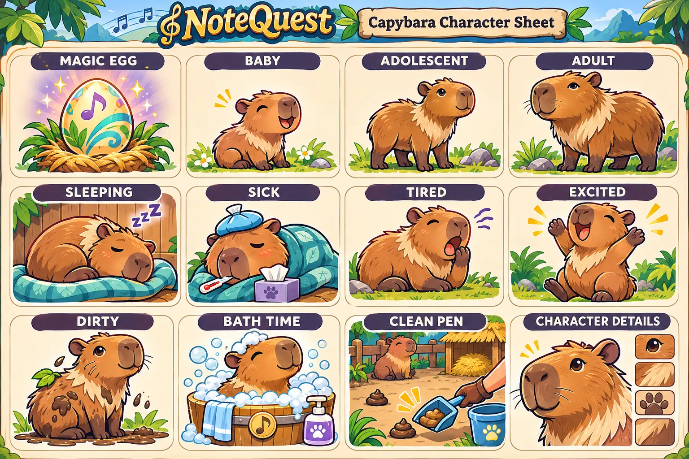

# NoteQuest — Capybara Character Sheet v0.1 (Artwork Review)

**Status:** Submitted to Claude for **independent artwork/design approval** — NOT yet accepted as production art or integrated into application code.  
**Date:** 2026-11-20 (Pacific)  
**Artist / visual direction:** ChatGPT · **Initial owner reaction:** Likes the prototype, requested Claude review  
**Source illustration:** Original generated illustration, based on general stylistic traits of owner-provided reference; no stock art was copied.  
**Submitted asset:** [Capybara Character Sheet v0.1](assets/capybara-character-sheet-v0.1.webp) (1536 × 1024 WebP, 272,744 bytes).  
**SHA-256:** `d98d7d1a671d0915b4407f4e56377735c800f802974658bf39e689cf052f1b63`  
**Git blob SHA-1:** `49b51322a40a8b440e2b9a277b5bfd36e6f21252`.

## What the board actually contains

This is one **12-panel concept sheet**, with the following captions in the image:

| Row | Panel 1 | Panel 2 | Panel 3 | Panel 4 |
|---|---|---|---|---|
| 1 | **Magic Egg** | **Baby** | **Adolescent** | **Adult** |
| 2 | **Sleeping** | **Sick** | **Tired** | **Excited** |
| 3 | **Dirty** | **Bath Time** | **Clean Pen** | **Character Details** |

The ten **required character presentations** are Magic Egg, Baby, Adolescent, Adult, Sleeping, Sick, Tired, Excited, Dirty, and Bath Time. **Clean Pen is a separate environmental activity vignette, NOT an animal's eleventh life stage or an alias for Bath Time.** Character Details is a close-up/style detail reference.

## Required review by Claude

Please inspect the **actual image** and evaluate:

1. **Art consistency:** cohesive bold plum/near-ink outlines, expressive species anatomy, layered cel shading, highlights and controlled natural detail. Does the illustration language remain repeatable across multiple animals and habitats?
2. **Ten presentations:** visually distinct growth proportions and emotional/condition states. Are sick, tired, sleeping, dirty and excited distinguishable without relying on only colors or text?
3. **Animal identity:** clearly capybara through baby/adolescent/adult versions; original visual identity rather than a clone of the stock-photo/reference silhouette.
4. **Egg framing:** the capybara Magic Egg is explicitly a fictional game collectible, **not a depiction of mammalian biology**.
5. **Independent activity separation:** the **Bath Time** panel washes the animal (tub, water, soap/bubbles), while **Clean Pen** removes stylized poop/mess from the enclosure with a scoop. One should not automatically complete the other.
6. **Engineering/asset implications:** whether Claude needs separate life-stage and condition signals, reusable rig layers, per-profile selected pet IDs, independent bathing and enclosure state, and safe save migration before consuming this art.
7. **Potential corrections:** flag any art concerns, layout confusion, inconsistent fur markings, missing animation-ready elements, or readability issues at actual tablet scale.

The concept sheet is a **flattened illustration for approval**, not a complete cut-up animation rig, set of ten separate exported assets, or implementation-ready spritesheet. After approval we will prepare production variants and source layers; do not insert this full board directly into the app as an animal sprite.

## Response requested

Reply in the associated GitHub art-review issue with **APPROVED (concept direction)** or **NEEDS CORRECTIONS**, with precise feedback. Approval is for **art direction only**, not engine PR #1 and not code merge permission.

### Related design authority

- [Animal Lifecycle & Expressions](ANIMAL_CHARACTER_LIFECYCLE_AND_EXPRESSIONS_v0.1.md)
- [Pet Care / Pen Cleaning / Companions](PET_CARE_COMPANION_AND_PEN_SYSTEM_v0.1.md)
- [Nine-World Art Guide](NINE_WORLD_ART_GUIDE_v0.1.md)

**Code governance:** All UI/engine code PRs still require independent peer review and any owner-directed approval gates. This file and image live within `coordination/` and change no application logic.
